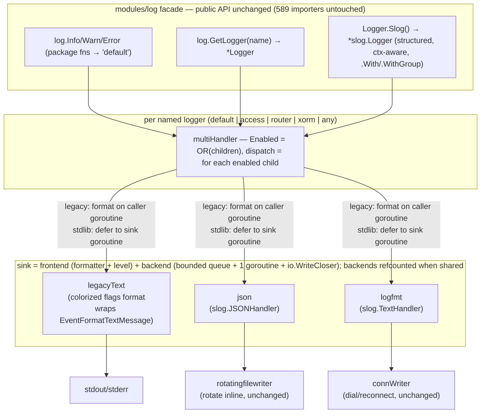

# Design: replace `modules/log` internals with `log/slog`

- Status: draft
- Date: 2026-08-27
- Scope: `modules/log`, `modules/setting/log.go`, `modules/testlogger`, `modules/test/logchecker`

## 1. Motivation and goals

`modules/log` is a bespoke ~5.5k LOC logging framework: custom levels, custom
fan-out, custom per-writer goroutines, custom text formatter. Go's `log/slog`
(stdlib since 1.21; this repo is on Go 1.26) provides levels, records,
handlers, and battle-tested `TextHandler`/`JSONHandler`. Keeping the bespoke
framework means maintaining an event pipeline, level sync, and formatter
duplicates of things the stdlib now ships.

Goals:

- Replace the **internals** of `modules/log` with slog-based machinery.
- Keep the existing text output byte-compatible as the default ("legacy"
  format option) — fail2ban/journal/users' parsers must not break.
- Keep **named loggers** (`default`, `access`, `router`, `xorm`, ad-hoc),
  adjustable per component via config.
- Keep **multi-sink** fan-out, including per-sink levels and shared sinks
  across loggers.
- Keep the public printf-style API so the 589 importing files (~2,845 direct
  `log.X(...)` call sites) need no changes.
- Gain: structured/JSON logging as an opt-in per-sink format, stdlib-maintained
  handlers, dynamic atomic levels.

Non-goals:

- The per-writer `Expression` regex filter is **dropped** (unused in default
  config, orthogonal to the sink design; nothing else depends on it).
- No big-bang migration of call sites to structured style. The facade exposes
  a `*slog.Logger` for incremental adoption.

## 2. Current architecture (facts the design must preserve)

Core pipeline (`modules/log/logger_impl.go`):

- `LoggerImpl` (one per logger name) fans `Event`s out to `EventWriter`s.
- Each writer has its own goroutine and a buffered channel (`BufferLen`,
  default 1000).
- **Formatting happens synchronously on the caller goroutine**
  (`SendLogEvent` calls `FormatMessage` per writer before enqueue). This is
  deliberate: `Event` carries printf format+args, and `Stringer` args must
  not be touched cross-goroutine.
- Enqueue is non-blocking: `select`/`default` → event dropped with a stderr
  fallback (`FallbackErrorf`). An unresponsive sink never blocks callers.
- Logger level = minimum of its writers' levels (`syncLevelInternal`,
  recomputed on writer add/remove); each writer also filters by its own level
  at dispatch.

Writers (`event_writer_{console,file,conn}.go`):

- `console` → stdout/stderr; `file` → `modules/util/rotatingfilewriter`
  (size + daily rotation, compression, keep-days; rotation happens inline in
  `Write` under the writer's own mutex); `conn` → TCP/UDP with
  dial/reconnect-on-msg options (blocking `net.Dial`, no deadline).
- External writer implementations: `modules/testlogger` (all Go tests),
  `modules/test/logchecker`.
- Shared writers: one writer instance referenced by multiple loggers,
  closed only when the manager shuts down (refcount-by-registry).

Format (`event_format.go`): flags-driven text layout —
`Ldate/Ltime/Lmicroseconds/LUTC`, `Lshortfile/Lmedfile/Llongfile`,
`Lfuncname/Lshortfuncname`, `Llevel/Llevelinitial`, deprecated `Lgopid`
placeholder, prefix, per-level ANSI colors, stacktrace below
`StacktraceLevel`.

Named loggers (`modules/setting/log.go`): `default`, `access`, `router`,
`xorm`, each configured via `logger.<name>.MODE = <mode1>,<mode2>` and
`[log.<mode>]` sections; any component can `log.GetLogger(name)` on demand.

Special integrations (all must keep working):

- XORM bridge (`models/db/log.go`) calls `Log` with **caller skip = 8**.
- Router logger (`modules/web/routing/logger.go`) **prefills `Caller`** with
  the route pattern.
- Access log renders a Go template and logs the buffer.
- `log.LoggerToWriter` bridges the stdlib `golog` into the default logger.
- `process.TraceCallback`, `rotatingfilewriter.ErrorPrintf`,
  `services/doctor` via `BaseLoggerToGeneralLogger`.
- `PauseAll`/`ResumeAll` — **dropped** (removed 2026-10-18: never had an
  internal consumer, no precedent in production loggers, and with synchronous
  writes it could only stall every logging caller; see `slog_new_design.md` §6),
  flush-with-timeout on close, `DumpLoggers`/`DumpWriters` introspection.
- Caller-side niceties: sensitive-URL masking, `LogStringer` (~53 impls),
  `ColoredValue` (fmt.Formatter-based ANSI wrapping, re-Sprintf'd per
  colorized sink).

## 3. Concept mapping

| modules/log today | log/slog |
|---|---|
| `LoggerImpl` per name | `*slog.Logger` per name over a per-logger handler tree; name also as `logger` attr |
| `EventWriter` | sink handler: formatter + bounded queue + 1 goroutine + `io.WriteCloser` |
| multi-sink fan-out | `multiHandler` (~40 LOC; stdlib has none) — `Enabled` = OR of children |
| `WriterMode.Level` + `syncLevelInternal` | per-sink `*slog.LevelVar` (atomic, dynamic) |
| `EventFormatTextMessage` | `legacyText` formatter reusing the existing code, fed from `Record` fields |
| console / file / conn writers | same io.WriteCloser stack behind sink handlers (unchanged) |
| `Event` printf format+args | preformatted `Record.Message` (+ hidden attrs for legacy colorization, see §9) |
| arbitrary caller skip | `Record.PC` via `runtime.Callers(skip)`; `Record.Source()` (public since Go 1.24) resolves file/line/function |
| prefilled `Event.Time` | `slog.NewRecord(t, level, msg, pc)` |
| prefilled `Event.Caller` (router) | hidden attr consumed by `legacyText` — `Record.Source()` derives from `PC` and cannot be overridden |
| third-party libs via `slog.Default()` | `slog.SetDefault(facade.Slog())` at init (reverse bridge into Gitea's sinks) |

## 4. Design constraints addressed

### 4.1 Unresponsive network sink

Per-sink bounded queue + one goroutine per sink + drop-on-overflow — the same
contract as today. Dispatch is non-blocking (`select`/`default` → drop +
`FallbackErrorf`). A stalled TCP peer blocks only its own sink goroutine;
bursts up to `BufferLen` are absorbed; overflow is dropped with a stderr
notice; request paths never block. Reconnect/dial logic stays in
`connWriter`. Improvement to add while porting (currently absent):
`net.DialContext` with timeout + `SetWriteDeadline`, so a dead peer cannot
wedge the sink goroutine indefinitely.

### 4.2 File rotation

Unchanged: `rotatingfilewriter` stays the io.Writer behind the file sink.
Rotation is orthogonal to slog — `Write` rotates inline (size/daily) under
the writer's mutex. One sink = one goroutine ⇒ rotation is serialized with
writes, no new races, including for shared file sinks. Shutdown drains the
queue then `Close()` → `Sync()`, same as `eventWriterStopWait` today.
`ReleaseReopen` (dump/PID-suffix restart paths) keeps working since the sink
holds the same writer instance.

### 4.3 One sink = one format

A sink is a handler instance owning exactly one formatter and one
io.Writer. The fan-out passes immutable records; each sink formats
independently; two formats means two sinks — enforced by construction, no
code path renders two formats into one sink. Config gains one key:
`FORMAT = legacy|logfmt|json` per mode section, default `legacy`. Shared
sinks are keyed by writer name in the manager (as today), so every logger
referencing `[log.file]` gets the same sink: same format, one file
handle, one goroutine. Internally a shared sink is a per-tree frontend
over a single refcounted backend (see §5) — the frontend clone is what
sits in each logger's handler tree.

### 4.4 Multiple sinks at different levels

Per-sink `slog.LevelVar`. `multiHandler.Enabled` = OR of children's
`Enabled` (atomic level reads) — replaces `syncLevelInternal`'s min-level
recompute with something cheaper and race-free. A record is built once (if
any sink wants it); dispatch re-checks each child's level and formats only
for sinks that pass:

```ini
[log]
MODE = console, file
LEVEL = Info            ; effective level = OR of sinks

[log.console]
LEVEL = Warn
FORMAT = legacy         ; colorized, flags

[log.file]
LEVEL = Trace
FORMAT = json
FILENAME = .../gitea.log
MAX_SIZE_SHIFT = 26
```

A `Debug` record: console says no, file says yes → built once, formatted
once (json), one queue push. A `Critical` record → both.

Level semantics parity: sinks are keyed by mode name (`writerName =
modeName`, plus the `.access` suffix special case), and the sink is
constructed once — **first logger wins**: a later logger referencing the
same mode reuses the existing sink, and its parsed level for that mode is
discarded. Per-sink level is therefore a property of the mode section,
not of the logger × mode pair; the `LevelVar`-per-sink design preserves
this.

## 5. Proposed architecture



### Facade `Logger` (per name, replaces `LoggerImpl`)

- Keeps `Trace/Debug/Info/Warn/Error/Critical/Fatal` and `Log(skip, ...)`
  printf API. Per call:
  1. level check (one atomic via `multiHandler.Enabled`),
  2. compute `PC` with `runtime.Callers(skip)` **only if the tree needs
     source** — cached `needsSource` flag (legacy file/funcname flags or
     `AddSource`); covers XORM's skip=8. Strictly cheaper than today,
     which runs `runtime.Caller` on every event.
  3. preformat the message **on the caller goroutine** — sensitive-URL
     masking, `LogStringer`, `ColoredValue` resolution — into a
     `slog.Record`; attach raw format+args as hidden attrs **only if a
     colorized legacy sink is active** (cached `wantsRawArgs` flag).
  4. dispatch via the logger's handler tree.
- `Fatal` = custom level + `Manager.Close()` + `OsExiter(1)` (unchanged).
- Exposes `Slog() *slog.Logger` for structured, ctx-aware use; attrs from
  `.With(...)` render natively in json/logfmt and as `key=value` suffix in
  legacy.
- Reverse bridge: `slog.SetDefault(<default facade logger>.Slog())` at
  init, so third-party libraries logging via `slog.Default()` land in
  Gitea's sinks (complements the existing outgoing `golog` bridge).

### `multiHandler`

~40 lines: OR-`Enabled`, per-child level re-check at dispatch,
`WithAttrs`/`WithGroup` fan-out. Each logger holds an immutable snapshot;
reconfiguration (admin panel, `RestartLogsWithPIDSuffix`) builds a new tree
and swaps it atomically. The tree also caches aggregate hints —
`needsSource`, `wantsRawArgs` (see facade) — recomputed when the tree is
rebuilt.

Teardown discipline on reconfigure: build new tree → swap pointer → drain
replaced non-shared backends with timeout. **The queue channel is never
closed**: stop is signaled via a done channel, and the enqueue side
selects on `queue` + `done`, dropping when stopping. This mirrors today's
`eventWriterStopWait` semantics, where a stopped writer's queue simply
fills and drops — never a send-on-closed-channel panic.

### Sink handler (replaces `EventWriter`/`EventWriterBaseImpl`)

**Frontend/backend split** (required for shared sinks):

- **Frontend** (implements `slog.Handler`): per-tree, cheap to clone;
  holds the level check, formatter choice, and `WithAttrs`/`WithGroup`
  state. slog requires `WithAttrs`/`WithGroup` to return new handlers and
  never mutate — cloning the frontend satisfies this while the shared
  backend stays untouched.
- **Backend** (refcounted by the manager): bounded `chan` + one goroutine
  + `io.WriteCloser`. Closed only when the last frontend goes away (same
  rule as today's shared writers).

Formatting vs. queueing, per format family:

- **`legacyText` formats eagerly on the caller goroutine at dispatch** and
  the queue carries `[]byte`. Same split as today's `SendLogEvent`, and
  required here: colorization re-Sprintfs the raw args (hidden attrs),
  which must not cross goroutines. `legacyText` wraps the existing
  `EventFormatTextMessage`, fed from `Record.Time/Level/Message/Source()`
  (`PC` covers `Lshortfile/Lmedfile/Lfuncname`); the router's prefilled
  caller name arrives as a hidden attr, since `Record.Source()` derives
  from `PC` and cannot be overridden.
- **`json`/`logfmt` queue a `Clone()`d Record and format on the sink
  goroutine** (stdlib `JSONHandler`/`TextHandler` over the sink's
  writer). Deferring moves reflection-heavy formatting off the request
  path and makes a full-queue drop cost nothing. This is the idiomatic
  slog async pattern; it is safe because slog's concurrency contract
  makes attr values the caller's responsibility — same as any stdlib
  handler user.

Queue push is non-blocking with drop-to-stderr (§4.1). Shutdown drains with
timeout; pause/resume per sink and manager-wide (`PauseAll`/`ResumeAll`)
are preserved. See the `multiHandler` section for the
never-close-the-queue teardown invariant.

### Manager (same role as today)

Name → facade logger, shared-sink registry with close-on-last-ref, config →
tree construction from `[log]` / `logger.<name>.MODE` / `[log.<mode>]`,
`DumpLoggers` (reports name/type/level/format/target), `Close` with flush.

### Level table

| modules/log | slog |
|---|---|
| `UNDEFINED` | config-parse sentinel (stays in `modules/setting`) |
| `TRACE` | `slog.LevelDebug - 4` |
| `DEBUG` | `slog.LevelDebug` |
| `INFO` | `slog.LevelInfo` |
| `WARN` | `slog.LevelWarn` |
| `ERROR` / `CRITICAL` (alias today) | `slog.LevelError` |
| `FATAL` | custom `slog.Level(12)` + exit in facade; a `ReplaceAttr` hook renames the stock `"ERROR+4"` rendering to `"FATAL"` in json/logfmt sinks |
| `NONE` | sink not attached / level above everything |

## 6. Data flow of one event

1. `log.Error("failed: %v", err)` → facade: `Enabled`? (OR of sink levels,
   atomics)
2. Caller goroutine: `PC` (only if `needsSource`), mask/resolve args,
   build `slog.Record` (hidden format+args attrs only if `wantsRawArgs`)
3. `multiHandler` dispatch: legacy sink → `legacyText` renders `[]byte`
   on the caller goroutine; json/logfmt sink → `Record.Clone()` enqueued,
   formatting deferred to the sink goroutine
4. Non-blocking enqueue; sink goroutine pops → format (if deferred) →
   `writer.Write` (stdout / rotating file / conn with reconnect)
5. Shutdown/rotate paths behave exactly as today

## 7. Compatibility and friction points

1. **Per-writer colorization (ColoredValue).** Today a `Colorize` sink
   re-Sprintfs format+args at dispatch for ANSI wrapping; a `slog.Record`
   carries only the preformatted message. Solution during migration: the
   facade attaches format+args via hidden record attrs, gated on the
   cached `wantsRawArgs` flag so trees without colorizing sinks pay
   nothing; `legacyText` uses them (still on the caller goroutine) for
   byte-identical output. Long-term: drop per-arg color in legacy mode.
2. **Printf API is not slog's model.** Call sites behind the facade format
   eagerly; structure only materializes where call sites adopt
   `Slog()`. Expected and acceptable; adoption is incremental.
3. **Async semantics move into handlers.** `Handle` is synchronous on the
   caller's goroutine; the queue/goroutine lives inside the sink handler.
   Net safety is better than today: the facade preformats, so the
   format+args handoff dance in `SendLogEvent` disappears.
4. **Level edge cases:** `FATAL` renders as `"ERROR+4"` under stock
   `JSONHandler`/`TextHandler`; the json/logfmt sink options carry a
   `ReplaceAttr` hook renaming it to `"FATAL"`. `NONE`/`FATAL` are plain
   ints, no obstacles.
5. **No-writer loggers:** today a logger with zero writers falls back to
   stderr with `[no logger writer]` — preserve the behavior (or make it
   silent; decision needed during implementation).
6. **External writers** (`testlogger`, `logchecker`) port to
   formatter+writer pairs; they are small and already shaped like handlers.
7. **Perf:** disabled-level fast path stays a single atomic compare (LevelVar
   vs today's `atomic.Int32`); one `Record` build shared by all sinks;
   three optimizations make enabled paths cheaper than today — lazy `PC`
   capture, conditional hidden attrs, and deferred formatting for
   json/logfmt sinks. To be verified by phase-1 benchmarks.

## 8. What gets deleted

Once phase 1 is byte-compatible: `EventWriterBaseImpl.Run` plumbing,
`syncLevelInternal`, the `Event`/`EventFormatted` msgArgs handoff,
`eventWriterStartGo`/`eventWriterStopWait`, the `Expression` filter
(~1.5–2k LOC). The queue/goroutine idea survives inside the sink handler —
expressed once, uniformly, without the writer-base interface.

## 9. Migration plan (no big-bang)

1. **Core swap inside `modules/log`**: `multiHandler`, sink handler,
   `legacyText`, LevelVar wiring; `LoggerImpl` keeps its exact public API
   but builds `slog.Record`s internally. No importer changes. All existing
   tests (`logger_test.go`, `event_format_test.go`, `setting/log_test.go`
   golden dumps) must pass byte-identical. Port `testlogger`/`logchecker`.
   Benchmarks: disabled fast path, single legacy console, single json
   sink (eager vs deferred), 3-sink fan-out — compared against current
   `modules/log`.
2. **Structured API**: expose `Slog()`; port high-value call sites
   (request/access logging with `request_id`, `user_id`, `repo` attrs).
3. **New sink formats**: `FORMAT = json|logfmt` via stdlib handlers
   (`MODE=file FORMAT=json` etc.); default stays `legacy`.
4. **Retire** the `EventWriter` interface and the bespoke formatter
   fast-path once the ports are done.

## 10. Gains vs risks

Gains: stdlib-maintained handlers, real structured logs (key-value attrs,
JSON output as opt-in per sink), simpler dynamic levels (atomics, no
recompute), interop with the slog ecosystem (libraries accepting
`slog.Handler`), ~1.5–2k LOC deletable, one uniform async pattern.

Risks: byte-compat of legacy output (mitigated: formatter reused verbatim +
existing golden tests; ColoredValue handled per §7.1), log-parsing tooling
breakage (mitigated: `legacy` default), perf regression (mitigated: phase-1
benchmark; fast path is one atomic either way).
