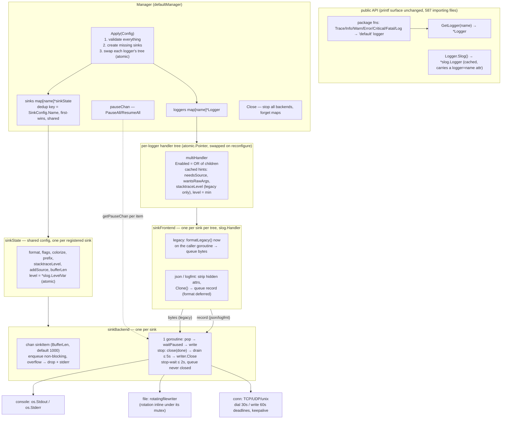
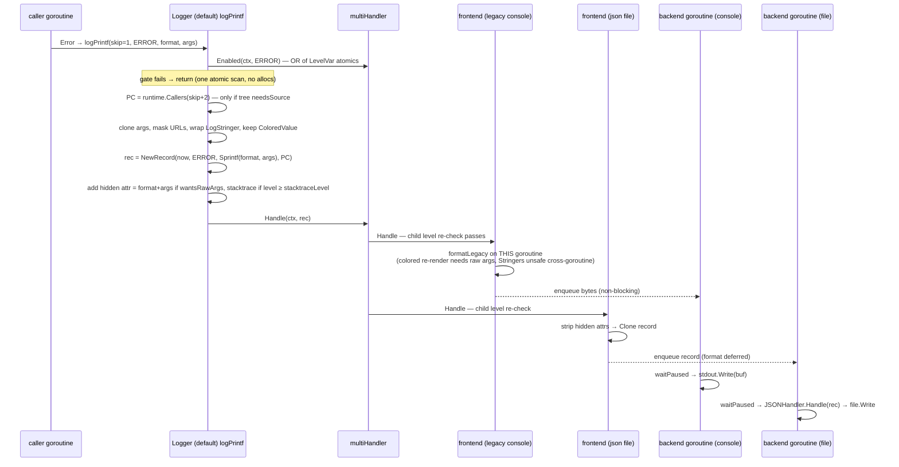
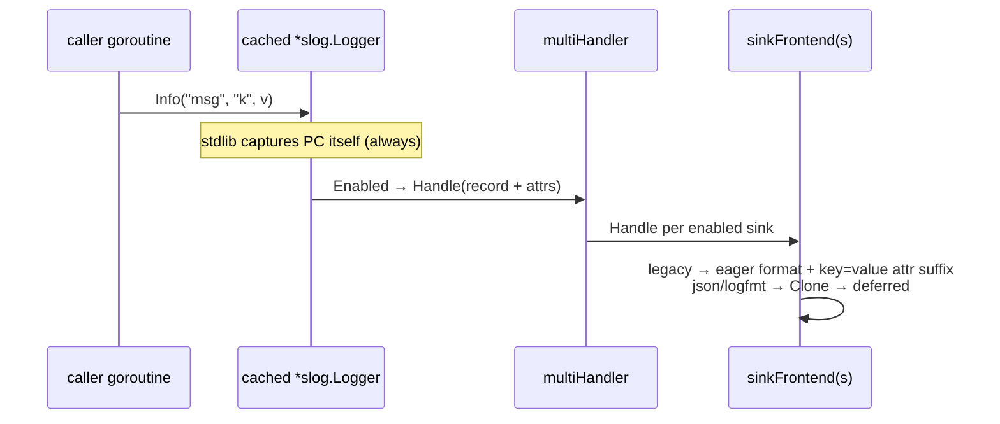

# New design: `modules/slog` — architecture, event flow, config migration

- Date: 2026-10-10
- Scope: `modules/slog` (branch `slog`, commit `efa20e3d4d`) as implemented, not as drafted
- Companions: `slog_design.md` (the plan), `slog_parity_notes.md` (audit vs `modules/log`)

## 1. Architecture of the logger

### 1.1 Component diagram

Ownership rules that make sharing safe:

- **frontend : backend is N : 1.** Each logger tree holds its own `sinkFrontend`
  clones (slog's `WithAttrs`/`WithGroup` must return new handlers); the queue,
  goroutine and io.Writer live in the refcount-by-registry `sinkBackend` and are
  created once per `SinkConfig.Name`.
- **State is read-only after creation.** `sinkState` fields never change; the
  only mutable knob is the `slog.LevelVar`. Reconfiguration builds new objects
  and swaps one pointer (`Logger.swapHandler`), it never mutates a running tree.
- **Hints live on the tree.** `needsSource` (any sink renders file/funcname or
  `AddSource`), `wantsRawArgs` (any colorized legacy sink), `stacktraceLevel`
  (min over legacy sinks) and `level` (min overall) are aggregated once when
  `newMultiHandler` builds the tree, so the hot path reads plain bools/ints.

### 1.2 Component mapping from `modules/log`

| modules/log | modules/slog | Notes |
|---|---|---|
| `LoggerImpl` + `LoggerManager` | `Logger` + `Manager` | Tree swap replaces writer add/remove; no more `syncLevelInternal` recompute |
| `EventWriterBaseImpl` (queue+goroutine) | `sinkBackend` | Same contract: bounded chan, drop-on-overflow, 1 goroutine, never-closed queue |
| `EventWriter` console/file/conn | `newSinkWriter` cases | conn gains dial/write deadlines + keepalive; file unchanged; console = nop WriteCloser |
| `EventFormatTextMessage` | `formatLegacy` | Port; consumes `Record` fields + hidden attrs; adds `key=value` attr suffix |
| `Event` struct (caller, stacktrace, msgArgs) | hidden attr `\x00gitea.hidden` | Single attr on the record; stripped before stdlib sinks see it |
| `SendLogEvent` per-writer format | `sinkFrontend.Handle` | Legacy still eager on caller goroutine; json/logfmt deferred (new) |
| `WriterMode.Level` + `syncLevelInternal` | `slog.LevelVar` + min in `newMultiHandler` | Aggregation is now correct (old assigned the wrong field, see parity notes §4) |
| `initLoggerByName` + `GetSharedWriter` | `Manager.Apply` first-wins | Config translation stays in `modules/setting` (see §3) |
| `misc.go` adapters | §4 below | `LoggerToWriter` ⇒ `slog.NewLogLogger` |

## 2. Call flow for a single log

### 2.1 printf path — `log.Error("failed: %v", err)` (the 587-importer hot path)

Numbered walk-through:

1. Package fn adds one skip level: `log.Error` → `Log(1,...)` → `Default().Log(skip+1)` — identical skip arithmetic to old `logger_global.go`.
2. Level gate: `multiHandler.Enabled` walks children, each a single `LevelVar` atomic compare. Old code did one `atomic.Int32` compare; the new gate is a short loop of atomics (a few ns, see parity notes §4.2).
3. `PC` capture is conditional — the tree's `needsSource` hint means `flags=none` sinks (access log) skip `runtime.Callers` entirely; old code ran `runtime.Caller` on every event.
4. Arg resolution happens on the caller goroutine: `protectSensitiveInfo` on string args, `LogStringer` → `fmt.Formatter`, `ColoredValue` passed through untouched.
5. One `slog.Record` is built for all sinks. Hidden attrs (single `\x00gitea.hidden` attr) carry only what some sink in this tree needs: raw printf format+args for colorized legacy re-rendering, precomputed stacktrace.
6. `multiHandler.Handle` re-checks each child's level, so a `Debug` record costs nothing at a `Warn`-level sink.
7. Legacy formatting stays on the caller goroutine (byte-compat + `ColoredValue` safety); json/logfmt pay only a strip + `Clone` here, and all reflection/encoding happens on the sink goroutine.
8. Enqueue is `select { done | queue | default: drop+FallbackErrorf }` — a stalled writer never blocks callers, same as old.

### 2.2 structured path — `GetLogger("x").Slog().Info("msg", "k", v)`

Differences vs the printf path:

- No hidden attrs are ever attached: no masking, no `LogStringer` resolution, no stacktrace rendering on this path (parity notes §2 item on masking applies here).
- PC is captured unconditionally by the stdlib `Logger` (the `needsSource` hint is a printf-path optimization only).
- `Fatal` on this path is just a level — process exit stays the facade's job (`Logger.Fatal` / package `Fatal`).

### 2.3 Failure and shutdown behavior (both paths)

- Queue full → event dropped, one stderr line naming the sink (old JSON-marshaled the event first).
- `PauseAll` → new `pauseChan`; sink goroutines block on it between items; `ResumeAll` closes it (nil-guarded — old panicked on double resume).
- `Manager.Close` / backend `stop`: `close(done)` → goroutine drains remaining items with a 5s deadline → `writer.Close()`; the stopper waits ≤ 2s. The queue channel is never closed, so a racing enqueue can at worst drop an event, never panic.

## 3. Configuration: previous logger port → new one

### 3.1 What replaced what

| Old (`modules/setting/log.go` + `modules/log`) | New (`modules/slog`) |
|---|---|
| INI: `[log]` global + `logger.<name>.MODE` + `[log.<mode>]` sections | `Config{Loggers []LoggerConfig{ Name, Sinks []SinkConfig }}` struct |
| `loadLogGlobalFrom` / `prepareLoggerConfig` deprecated-key aliases (`ACCESS`, `ROUTER`, `XORM`, `ENABLE_*`, `DISABLE_ROUTER_LOG`) | none — INI translation stays in the setting layer (still to be ported) |
| `initLoggerByName`: `","` sentinel = "use `[log] MODE`", `""` = disabled | explicit per-logger `LoggerConfig`; absent = untouched, sinks=[] = silent logger |
| writer name = mode name (`"file"`, `"console"`) + `".access"` suffix special case | `SinkConfig.Name` is the dedup key, set by the caller — no implicit suffix rule |
| `GetSharedWriter`/`NewSharedWriter` registry | first-wins `m.sinks[sc.Name]` in `Apply` |
| one text format (flags-driven) | `Format = legacy (default) / logfmt / json` per sink |
| `WriterMode`: Level, StacktraceLevel, Prefix, Flags, Expression, BufferLen, WriterOption | `SinkConfig`: same minus Expression (dropped by design), plus Format, AddSource, typed `Console/File/Conn` option structs |
| `SetupStderrLogger(name, "console-stderr", level)` (non-shared writer each call) | `StderrConfig(logger, level)` — **hard-codes sink name `"console-stderr"`** |
| `ReplaceAllWriters` on re-init (stop non-shared, start new) | `Apply` swaps trees atomically; replaced backends keep running (parity: old also reused shared writers by name) |
| writer error → `FallbackErrorf`, config errors → log + `continue` (half-applied) | `Apply` validates everything first, then applies; first error aborts before any mutation |
| `RestartLogsWithPIDSuffix` (PID filename suffix + re-init) | not modeled — `FileSinkOptions.FileName` is raw; port re-runs the INI translation (same shared-writer-reuse quirk as old) |

### 3.2 Pros

1. **Validate-then-apply.** A bad sink type/format aborts with an error before any logger is touched. Old code `FallbackErrorf`+`continue`'d its way to a half-applied config and continued boot.
2. **Explicit shared-sink identity.** Sharing is keyed by an explicit, visible `Name` instead of a writer-name string assembled with a hidden `".access"` mutation inside the INI loader.
3. **Format is a per-sink property, enforced by construction.** One frontend = one formatter; the old design could not express "json to file, legacy to console" at all.
4. **Reconfigure is a pointer swap.** No stop/start of writer goroutines under a manager mutex; loggers not mentioned in the new config keep running untouched.
5. **Testable without INI.** `Config` is a plain struct; golden tests build trees directly (`newSinkWithWriter`) with no `CfgProvider` coupling.
6. **Fewer knobs that can disagree.** Old code had three level notions to keep in sync (writer level, logger min-level, stacktrace min-level) with an actual aggregation bug; new code has one `LevelVar` per sink and derives everything else once per tree build.

### 3.3 Cons and issues

1. **Sink-name collision trap (P1 #4 in parity notes).** `StderrConfig` hard-codes `"console-stderr"`. The port of `InitSQLLoggersForCli` must namespace per logger (e.g. `"console-stderr-xorm"`), or the xorm logger silently inherits the default logger's sink level. The old `SetupStderrLogger` bypassed the shared registry, so it never had this failure mode.
2. **First-wins is silent.** When two loggers reference the same sink name, the second one's `Level`/`Format`/options are discarded without a warning. This matches old config-driven behavior, but old code's `.access` suffix reduced how often it happened by accident. An `Apply` warning (or error option) would make misconfiguration visible.
3. **Defaults drift — the port must not rely on zero values:**
   - `BufferLen`: old global default **10000** (`[log] BUFFER_LEN`), new sink default **1000**. A naive port changes queue depth 10×.
   - `FileSinkOptions`: the `config.go` comment claims zero values fall back to rotatingfilewriter defaults ("size 1<<28, daily, 7 days, compress") — **that is wrong**: `rotatingfilewriter.Open` performs no normalization; `Rotate=false` means no rotation at all, and `KeepDays`/`Compress` zero-values disable retention/compression. The INI port must set every file option explicitly from old defaults (`LOG_ROTATE=true`, `MAX_SIZE_SHIFT=28`, `DAILY_ROTATE=true`, `MAX_DAYS=7`, `COMPRESS=true`, `COMPRESSION_LEVEL=-1`); the comment should be fixed regardless.
   - `ConnSinkOptions`: no `ADDR` default (old: `:7020`); zero dial/write timeouts map to 30s/60s defaults (fine), but an empty addr dials garbage.
   - `Colorize`: old console sinks defaulted to `CanColorStdout`/`CanColorStderr`; new requires explicit — the port must wire the same defaults or color output changes.
   - `Flags`: zero value = `LstdFlags`, matching old `"stdflags"` default — OK.
4. **Access-log special case has no home.** Old: access writer name gets `".access"`, default flags `"none"`, default file `access.log`. All three must be reproduced by the setting port (distinct sink names per mode, explicit flags, explicit filename) — a naive "mode name = sink name" port would make access share the default logger's console/file sink and inherit its flags.
5. **External writers blocked.** `Apply` validates only console/file/conn, and `newSinkWithWriter` is unexported. `modules/testlogger` (every Go test) and `modules/test/logchecker` cannot attach. Public escape hatch needed — the new package's own tests demonstrate the shape (`SinkConfig` + `io.WriteCloser`).
6. **No dynamic level setter.** `LevelVar` exists but nothing exports `Set`/`Get` on a running sink — the "dynamic atomic levels" gain is unreachable until `Apply` (or a new API) can address a registered sink.
7. **`Expression` filter gone.** Accepted in design §1, but it is a user-visible config key removal (`[log.<mode>] EXPRESSION`) — release-note material, and old configs carrying it now fail validation instead of filtering.
8. **Introspection shape changed (P1 #6).** Admin config page consumes `DumpLoggers()`; new `Dump()` reports sinks+loggers with different keys. Port must either adapt the page or reshape `Dump`.
9. **Disabled-logger semantics differ subtly on re-init.** Old: `logger.x.MODE=""` → `initLoggerByName` returns early → logger keeps its previous writers across `RestartLogsWithPIDSuffix`. New: absent from `Config` = untouched (same), but explicit empty `Sinks` = silent logger. The port must choose deliberately which of the two "disabled" means.
10. **Re-init can't change a shared sink.** Because sinks are reused by name, re-running `Apply` after config edits only affects newly named sinks. Old re-init had the same property for shared writers, so it's parity — but combined with issue 6 it means "change log level at runtime" is currently impossible without `Manager.Close`.

### 3.4 Checklist for the `modules/setting` port

- Keep `prepareLoggerConfig` (deprecated aliases, `","`/`""` sentinels) as-is; translate its output to `Config`.
- Resolve `FILE_NAME` via `LogPrepareFilenameForWriter` (ROOT_PATH join, `MkdirAll`-panic behavior, PID suffix on restart).
- Per-logger sink names: `modeName` for built-ins, `modeName+".access"` for access; unique names for `SetupStderrLogger` equivalents.
- Set `Colorize` from `CanColorStdout`/`CanColorStderr` (+`STDERR`), all file options from INI defaults, `BufferLen` from `[log] BUFFER_LEN` (decide: keep 10000 or adopt 1000).
- Wire `golog` bridge after `Apply` (see §4).
- Map admin `DumpLoggers` consumer to the new `Dump` shape.

## 4. Adapter porting: what `slog.NewLogLogger` absorbs

`slog.NewLogLogger(h Handler, level Level) *log.Logger` dispatches each `Write` as a Record at a fixed level, capturing PC via `runtime.Callers(3)` (i.e. the caller of the stdlib `log` call).

| Adapter (old) | Port | Verdict |
|---|---|---|
| `LoggerToWriter(GetLogger(DEFAULT).Info)` — golog bridge (setting/log.go:200, cmd/doctor.go:103,175) | `golog.SetOutput(slog.NewLogLogger(l.Slog().Handler(), slog.LevelInfo))` | **Replaced.** Strictly better: PC now points at the real `golog` caller instead of `loggerToWriter.Write`; output still non-blocking (legacy frontend formats eagerly, stdlib frontends enqueue). Caveats: message keeps golog's trailing `\n` (legacy strips one; json/logfmt will embed it in `msg`); no `protectSensitiveInfo` on this path (old masked via the printf path — negligible: only fires when the entire written line parses as an http URL). Keep `golog.SetFlags(0)`/`SetPrefix("")` as today. |
| `PrintfLogger` (misc.go:59) | drop | No non-test callers. Wherever an `io.Writer`-ish shim is needed, `NewLogLogger` covers it. |
| `BaseLoggerToGeneralLogger` + `baseToLogger` (misc.go:15) | mostly delete | `NewLogLogger` doesn't apply (`BaseLogger` is a printf interface, not an `io.Writer`). But the new `*Logger` already *is* the general logger (`Log/GetLevel/LevelEnabled/Trace..Fatal`), so doctor can target it or a ~10-line shim for `Base`-implementors like `doctorCheckLogger`; the `*Event` parameter disappears from the shim signature. |
| `ErrorWithSkip` (logger_global.go:49) | 2-line package fn on `Default().Log` | Keep; explicit skip plumbing is inherently custom. |
| `IsLoggerEnabled` (logger_global.go:66) | `GetLogger(name).GetLevel() != LevelNone` | Old = `level < FATAL && len(writers) > 0` (`LoggerImpl.IsEnabled`). New `GetLevel()` returns `LevelNone` exactly when the tree has no sinks, so `!= LevelNone` is equivalent for any realistic config; only the degenerate FATAL-only logger differs. |
| `Level.ColorAttributes()` (level.go:74) | export `levelColorAttrs` (e.g. `LevelColors`) | Only consumer is `routing/logger.go` colored messages; trivial. |
| `rotatingfilewriter.ErrorPrintf = FallbackErrorf`, `process.TraceCallback = ...` (modules/log/init.go:25,27) | re-assign to `modules/slog.FallbackErrorf` / a closure over `Default().Log` | Init-time wiring, no adapter type needed. |
