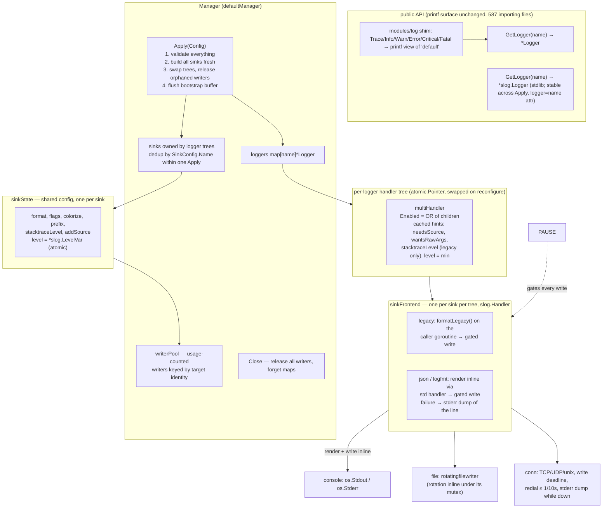
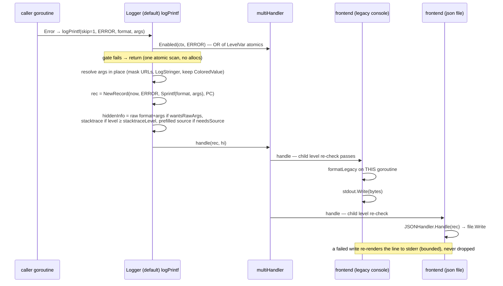
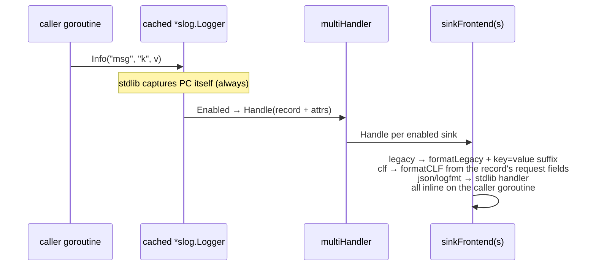

# New design: `modules/slog` — architecture, event flow, config migration

- Date: 2026-10-10
- Scope: `modules/slog` (branch `slog`, commit `efa20e3d4d`) as implemented, not as drafted
- Companions: `slog_design.md` (the plan), `slog_parity_notes.md` (audit vs `modules/log`)

## 1. Architecture of the logger

### 1.1 Component diagram



Ownership rules that make sharing safe:

- **frontend : state is N : 1.** Each logger tree holds its own `sinkFrontend`
  clones (slog's `WithAttrs`/`WithGroup` must return new handlers); the config,
  level and writer live in the shared `sinkState`, created once per sink within
  an `Apply` call. Writes are synchronous on the caller goroutine — the Caddy
  model, chosen after measurement showed the async queue bought only ~20%
  caller time on a path dominated by formatting (see §6) — so there are no
  queues, no drops and no drain timeouts.
- **State is read-only after creation.** `sinkState` fields never change; the
  only mutable knob is the `slog.LevelVar`. Reconfiguration builds new objects
  and swaps one pointer (`Logger.swapHandler`), it never mutates a running tree.
- **Hints live on the tree.** `needsSource` (any sink renders file/funcname or
  `AddSource`), `wantsRawArgs` (any colorized legacy sink), `stacktraceLevel`
  (min over legacy sinks) and `level` (min overall) are aggregated once when
  `newMultiHandler` builds the tree, so the hot path reads plain bools/ints.

### 1.3 Writer registry

Ported from Caddy's `WriterOpener`/`UsagePool` pair (writer.go). A sink never
opens an output itself; it describes one:

```go
type WriterOpener interface {
	fmt.Stringer
	WriterKey() string                    // target identity: "file:/path", "net:tcp//host:port", "std:out", "registered:<type>"
	OpenWriter() (io.WriteCloser, error)
}
```

`Manager.writers` is a usage-counted pool keyed by `WriterKey`:

- **Same target ⇒ one writer.** Two sinks with the same `FILE_NAME` (any sink
  names, any formats/levels — those are per-sink) share one `RotatingFileWriter`,
  so rotation state can never diverge and there is no second fd appending
  behind the rotator's back. Same for one TCP connection shared by two sinks.
- **Refcount by sink.** Each sink acquires on build and releases after its
  backend has fully stopped (provision orphan sweep and `Manager.Close`); the
  writer closes when the last reference drops. Re-applying a config with the
  same target therefore keeps the open file instead of close/reopen.
- **Settings first-wins, reported.** The pool stores a `%#v` repr of the
  opener's fields; a second sink with divergent settings (e.g. different roll
  options on the same file) keeps the existing writer and the divergence is
  reported to stderr once per writer. Registered sink types are opaque
  factories, so only their type is comparable (per-type sharing, which also
  matches testlogger's singleton writer).
- **Injected writers bypass the pool.** `Manager.apply`'s test injection wires
  a writer directly; release closes it (recorders assert this).
- **`RotatingFileWriter` serialization.** Sharing means two sink goroutines
  can call `Write` concurrently, so `Write` now holds the writer mutex and
  `DoRotate` runs through an unlocked `doRotate` — previously `Write` was
  unlocked and rotation could swap the fd under an in-flight write.

- **`connWriter` failure semantics** (port of Caddy's `redialerConn`): a
  failed write retries once (a concurrent writer may have reconnected under
  the lock), redials are rate-limited to one per 10s so a down remote never
  turns emissions into blocking dials, and every write carries a deadline —
  unlike Caddy, whose sync engine blocks forever on a stalled reader. On any
  sink write error the caller dumps the formatted line to stderr (capped at
  32 KiB) before the error notice, so the event content survives.
  `RECONNECT`/`RECONNECT_ON_MSG` are accepted config keys but no-ops:
  reconnection is always automatic.

> Sidenote: Caddy has since replaced lumberjack with timberjack for file
> rotation, gaining count-based retention (`roll_keep`) alongside days
> (`roll_keep_for`), at-time rotation (`roll_at` / `roll_minutes` /
> `roll_interval`) and configurable file modes (`mode`, create + chmod-if-
> different). Our `rotatingfilewriter` has size + daily + keep-days only —
> count-based retention and file modes are the interesting gaps, not planned
> for now.

### 1.4 Bootstrap buffer

Ported from Caddy's `BufferedLog`/`LogBufferCore` (`internal/logbuffer.go`),
with the flush driven by `Apply` instead of manual error paths. Every new
logger's tree starts with a `bufferChild`: until an Apply configures the
logger, its events are captured into a bounded per-manager ring (oldest
dropped, drop count reported on flush), and `Apply` replays them into the
newly configured trees — same order, same formats, prefilled source, so
replayed events are indistinguishable from direct ones. Events of loggers an
Apply does not configure stay buffered until a later Apply configures them.

- **Capture floor.** `SetBootstrapLevel` gates what is captured; the CLI's
  `--quiet`/`--debug`/`--verbose` map onto it. This replaced the old
  provisional stderr logger and its FORMAT-ini peek: replayed events carry the
  user's real format and destination instead of a guess, and git-protocol
  sub-commands (`serv`/`keys`/`hook`, FATAL floor) stay silent.
- **Not a sink.** The buffer never counts as "accepted": a pre-configuration
  `Fatal` still echoes to stderr, since `Close` discards the buffer.
- **Spill.** `SpillBufferedEvents` is the CLI's flush-on-exit (the equivalent
  of Caddy's `FlushTo(defaultLogger)` on error paths): a command that never
  applies a logging configuration still surfaces its buffered events, on
  stderr, gated on the default logger never having been configured.
- **Long-lived flows must apply.** Buffering only helps if an `Apply` eventually
  arrives in the same process. The installer is the one flow that serves for a
  long time without any configuration existing (there is no app.ini yet, and
  install completion restarts the process, so a buffer spill would never run):
  `serveInstall` therefore applies an explicit console logger at the bootstrap
  level, like every CLI command does.

### 1.5 Public API

- `GetLogger(name)` / `Default()` return a **stdlib `*slog.Logger`**. Its handler
  is a `dynamicHandler` over the logger's atomic tree pointer: the value is
  stable for the process lifetime, follows every `Apply`, replays `With`/
  `WithGroup` state per tree generation, and can be stored in package vars or
  passed to downstream libraries that accept `*slog.Logger` (or `Handler()` for
  handler-taking libraries).
- The printf API exists only on the transitional **`PrintfLogger` view** used by
  the `modules/log` shim (`GetPrintfLogger(name).LogPC(...)`); its package-level
  forwarders capture the caller PC themselves. `modules/slog/global.go` (the
  printf package functions) is deleted — the shim owns those names.
- `Fatal` (echo + Close + exit) also lives on the transitional path; stdlib
  logging leaves process exit to the caller by design.

## 6. Evaluation: sync vs async write path (Caddy comparison)

**Decided 2026-10-18: the engine is fully synchronous** (Caddy's model). The
per-sink queue/goroutine machinery was removed: frontends render and write
inline, overflow-drops no longer exist, and `BUFFER_LEN` is dead config. Stalls
are bounded: file/console writes are effectively never slow, and `connWriter`'s
write deadline plus rate-limited redial converts a stalled remote into the same
error→stderr-dump path.

`PauseAll`/`ResumeAll` and the `gitea manager logging pause|resume` CLI/API
surface were removed with the same change: the control existed to stop disk
writes without a restart, but with synchronous writes it can only stall every
logging caller (the access middleware alone would freeze each subsequent
request), and it has no precedent in production loggers — journald rate-limits,
nginx/Apache only reopen. `release-and-reopen` stays for logrotate. The measurements that drove the decision, taken on the async engine
(before removal; kept for the record):

| benchmark | ns/op (caller) |
|---|---|
| `RawFileAppend` (syscall floor, 128 B) | ~1400 |
| `SyncLegacyFile` (Caddy model: render + write inline) | ~7400 |
| `SyncLegacyFileParallel` -8 (8-way writer contention) | ~7500 |
| `AsyncLegacyFile` (old model: eager render + enqueue) | ~5100-7000 |
| `PrintfLegacyPlain` (async, zero-cost writer) | ~3200 |

The eager legacy render (~3µs) dominated both models; the goroutine only
offloaded the ~1.4µs syscall (~20% caller time), and 8-way writer contention
added ~5% in the sync model. After the switch, the shipped engine measures
~2.1µs (legacy console) / ~3.1µs (legacy file) end-to-end — on par or faster
than the async engine, with no drops, no drain timeouts, no per-sink
goroutines and no queue memory.


### 1.2 Component mapping from `modules/log`

| modules/log | modules/slog | Notes |
|---|---|---|
| `LoggerImpl` + `LoggerManager` | `Logger` + `Manager` | Tree swap replaces writer add/remove; no more `syncLevelInternal` recompute |
| `EventWriterBaseImpl` (queue+goroutine) | `sinkBackend` | Same contract: bounded chan, drop-on-overflow, 1 goroutine, never-closed queue |
| `EventWriter` console/file/conn | `WriterOpener` openers (writer.go) | conn gains dial/write deadlines + keepalive; file unchanged; console = nop WriteCloser |
| `EventFormatTextMessage` | `formatLegacy` | Port; consumes `Record` fields + hidden attrs; adds `key=value` attr suffix |
| `Event` struct (caller, stacktrace, msgArgs) | hidden attr `\x00gitea.hidden` | Single attr on the record; stripped before stdlib sinks see it |
| `SendLogEvent` per-writer format | `sinkFrontend.Handle` | Legacy still eager on caller goroutine; json/logfmt deferred (new) |
| `WriterMode.Level` + `syncLevelInternal` | `slog.LevelVar` + min in `newMultiHandler` | Aggregation is now correct (old assigned the wrong field, see parity notes §4) |
| `initLoggerByName` + `GetSharedWriter` | `Manager.Apply` first-wins (sinks), `writerPool` (writers) | Config translation stays in `modules/setting` (see §3); writer dedup moved to target identity, see §1.3 |
| `misc.go` adapters | §4 below | `LoggerToWriter` ⇒ `slog.NewLogLogger` |

## 2. Call flow for a single log

### 2.1 printf path — `log.Error("failed: %v", err)` (the 587-importer hot path)



Numbered walk-through:

1. The shim captures the caller PC itself (`shimPC()`, `//go:noinline`) and calls `slog.DefaultPrintfLogger().LogPC(pc, …)` — no skip arithmetic through wrappers, same PC-passing discipline as before.
2. Level gate: `multiHandler.Enabled` walks children, each a single `LevelVar` atomic compare. Old code did one `atomic.Int32` compare; the new gate is a short loop of atomics (a few ns, see parity notes §4.2).
3. `PC` capture is conditional — the tree's `needsSource` hint means `flags=none`/CLF sinks (access log) skip `runtime.Callers` entirely; old code ran `runtime.Caller` on every event.
4. Arg resolution happens on the caller goroutine: `protectSensitiveInfo` on string args, `LogStringer` → `fmt.Formatter`, `ColoredValue` passed through untouched.
5. One `slog.Record` is built for all sinks. The `hiddenInfo` side channel carries only what some sink in this tree needs: raw printf format+args for colorized legacy re-rendering, precomputed stacktrace, prefilled source.
6. `multiHandler.handle` re-checks each child's level, so a `Debug` record costs nothing at a `Warn`-level sink.
7. All rendering happens on the caller goroutine (the sync model, §6): legacy via `formatLegacy`, CLF via `formatCLF`, json/logfmt via the stdlib handler — no clone, no queue, no sink goroutine.
8. Writes are synchronous; a failed write re-renders the line to stderr (capped) and reports the error, so an event is never silently dropped.

### 2.2 structured path — `GetLogger("x").Info("msg", "k", v)`



Differences vs the printf path:

- No hidden info is ever attached: no masking, no `LogStringer` resolution, no stacktrace rendering on this path (parity notes §2 item on masking applies here).
- PC is captured unconditionally by the stdlib `Logger` (the `needsSource` hint is a printf-path optimization only).
- `Fatal` on this path is just a level — process exit stays the shim's job (`log.Fatal`).
- The access logger emits on this path: one structured record per request (method, path, proto, status, size, duration_ms, identity, referer, user_agent, optional request_id); the sink's `FORMAT` decides the shape, `clf` rendering the Apache combined line.

### 2.3 Failure and write behavior (both paths)

- Writer error → the line is re-rendered to stderr (capped at 32 KiB) with an error notice naming the sink; the sync engine never queues, so nothing is dropped silently.
- `Manager.Close` → releases all writers (the pool closes each on its last reference); there is nothing to drain because writes are synchronous.

## 3. Configuration: previous logger port → new one

### 3.1 What replaced what

| Old (`modules/setting/log.go` + `modules/log`) | New (`modules/slog`) |
|---|---|
| INI: `[log]` global + `logger.<name>.MODE` + `[log.<mode>]` sections | `Config{Loggers []LoggerConfig{ Name, Sinks []SinkConfig }}` struct |
| `loadLogGlobalFrom` / `prepareLoggerConfig` deprecated-key aliases (`ACCESS`, `ROUTER`, `XORM`, `ENABLE_*`, `DISABLE_ROUTER_LOG`) | none — INI translation stays in the setting layer (still to be ported) |
| `initLoggerByName`: `","` sentinel = "use `[log] MODE`", `""` = disabled | explicit per-logger `LoggerConfig`; absent = untouched, sinks=[] = silent logger |
| writer name = mode name (`"file"`, `"console"`) + `".access"` suffix special case | `SinkConfig.Name` is the dedup key, set by the caller — no implicit suffix rule |
| `GetSharedWriter`/`NewSharedWriter` registry (reuse by name across re-inits) | fresh sinks per `Apply`, deduped within the call; orphaned backends stopped |
| one text format (flags-driven) | `Format = legacy (default) / logfmt / json` per sink |
| `WriterMode`: Level, StacktraceLevel, Prefix, Flags, Expression, BufferLen, WriterOption | `SinkConfig`: same minus Expression (dropped by design), plus Format, AddSource, typed `Console/File/Conn` option structs |
| `SetupStderrLogger(name, "console-stderr", level)` (non-shared writer each call) | `StderrConfig(logger, level)` — **hard-codes sink name `"console-stderr"`** |
| `ReplaceAllWriters` on re-init (stop non-shared, start new) | `Apply` swaps trees atomically; replaced backends keep running (parity: old also reused shared writers by name) |
| writer error → `FallbackErrorf`, config errors → log + `continue` (half-applied) | `Apply` validates everything first, then applies; first error aborts before any mutation |
| `RestartLogsWithPIDSuffix` (PID filename suffix + re-init) | not modeled — `FileSinkOptions.FileName` is raw; port re-runs the INI translation (same shared-writer-reuse quirk as old) |

### 3.2 Pros

1. **Validate-then-apply.** A bad sink type/format aborts with an error before any logger is touched. Old code `FallbackErrorf`+`continue`'d its way to a half-applied config and continued boot.
2. **Explicit shared-sink identity.** Sharing is keyed by an explicit, visible `Name` instead of a writer-name string assembled with a hidden `".access"` mutation inside the INI loader.
3. **Format is a per-sink property, enforced by construction.** One frontend = one formatter; the old design could not express "json to file, legacy to console" at all.
4. **Reconfigure is a pointer swap.** No stop/start of writer goroutines under a manager mutex; loggers not mentioned in the new config keep running untouched.
5. **Testable without INI.** `Config` is a plain struct; golden tests build trees directly (`newSinkWithWriter`) with no `CfgProvider` coupling.
6. **Fewer knobs that can disagree.** Old code had three level notions to keep in sync (writer level, logger min-level, stacktrace min-level) with an actual aggregation bug; new code has one `LevelVar` per sink and derives everything else once per tree build.

### 3.3 Cons and issues

1. **Sink-name collision trap (P1 #4 in parity notes).** *Resolved 2026-10-11: sinks are built fresh per `Apply`, so a second logger listing `"console-stderr"` gets its own sink — namespacing is now a readability concern only.* `StderrConfig` still hard-codes the name; keep distinct names in the port for a readable `Dump`.
2. **Same-name sinks within one `Apply` take the first config.** Deduplication is by name within the call (that's what makes sharing work), so two loggers listing one sink name should carry identical options — same rule as the config proposal's section model. Cross-call surprises are gone (fresh build every time).
3. **Defaults drift — the port must not rely on zero values:**
   - `BufferLen`: old global default **10000** (`[log] BUFFER_LEN`), new sink default **1000**. A naive port changes queue depth 10×.
   - `FileSinkOptions`: the `config.go` comment claims zero values fall back to rotatingfilewriter defaults ("size 1<<28, daily, 7 days, compress") — **that is wrong**: `rotatingfilewriter.Open` performs no normalization; `Rotate=false` means no rotation at all, and `KeepDays`/`Compress` zero-values disable retention/compression. The INI port must set every file option explicitly from old defaults (`LOG_ROTATE=true`, `MAX_SIZE_SHIFT=28`, `DAILY_ROTATE=true`, `MAX_DAYS=7`, `COMPRESS=true`, `COMPRESSION_LEVEL=-1`); the comment should be fixed regardless.
   - `ConnSinkOptions`: no `ADDR` default (old: `:7020`); zero dial/write timeouts map to 30s/60s defaults (fine), but an empty addr dials garbage.
   - `Colorize`: old console sinks defaulted to `CanColorStdout`/`CanColorStderr`; new requires explicit — the port must wire the same defaults or color output changes.
   - `Flags`: zero value = `LstdFlags`, matching old `"stdflags"` default — OK.
4. **Access-log special case has no home.** Old: access writer name gets `".access"`, default flags `"none"`, default file `access.log`. All three must be reproduced by the setting port (distinct sink names per mode, explicit flags, explicit filename) — a naive "mode name = sink name" port would make access share the default logger's console/file sink and inherit its flags.
5. **External writers blocked.** `Apply` validates only console/file/conn, and `newSinkWithWriter` is unexported. `modules/testlogger` (every Go test) and `modules/test/logchecker` cannot attach. Public escape hatch needed — the new package's own tests demonstrate the shape (`SinkConfig` + `io.WriteCloser`).
6. **No dynamic level setter.** `LevelVar` exists but nothing exports `Set`/`Get` on a running sink — the "dynamic atomic levels" gain is unreachable until `Apply` (or a new API) can address a registered sink.
7. **`Expression` filter gone.** Accepted in design §1, but it is a user-visible config key removal (`[log.<mode>] EXPRESSION`) — release-note material, and old configs carrying it now fail validation instead of filtering.
8. **Introspection shape changed (P1 #6).** Admin config page consumes `DumpLoggers()`; new `Dump()` reports sinks+loggers with different keys. Port must either adapt the page or reshape `Dump`.
9. **Disabled-logger semantics differ subtly on re-init.** Old: `logger.x.MODE=""` → `initLoggerByName` returns early → logger keeps its previous writers across `RestartLogsWithPIDSuffix`. New: absent from `Config` = untouched (same), but explicit empty `Sinks` = silent logger. The port must choose deliberately which of the two "disabled" means.
10. **Re-init can't change a shared sink.** Because sinks are reused by name, re-running `Apply` after config edits only affects newly named sinks. Old re-init had the same property for shared writers, so it's parity — but combined with issue 6 it means "change log level at runtime" is currently impossible without `Manager.Close`.

### 3.4 Checklist for the `modules/setting` port

- Keep `prepareLoggerConfig` (deprecated aliases, `","`/`""` sentinels) as-is; translate its output to `Config`.
- Resolve `FILE_NAME` via `LogPrepareFilenameForWriter` (ROOT_PATH join, `MkdirAll`-panic behavior, PID suffix on restart).
- Per-logger sink names: `modeName` for built-ins, `modeName+".access"` for access; distinct names for `SetupStderrLogger` equivalents (readability — correctness no longer depends on it).
- Set `Colorize` from `CanColorStdout`/`CanColorStderr` (+`STDERR`), all file options from INI defaults, `BufferLen` from `[log] BUFFER_LEN` (decide: keep 10000 or adopt 1000).
- Wire `golog` bridge after `Apply` (see §4).
- Map admin `DumpLoggers` consumer to the new `Dump` shape.

## 4. Adapter porting: what `slog.NewLogLogger` absorbs

`slog.NewLogLogger(h Handler, level Level) *log.Logger` dispatches each `Write` as a Record at a fixed level, capturing PC via `runtime.Callers(3)` (i.e. the caller of the stdlib `log` call).

| Adapter (old) | Port | Verdict |
|---|---|---|
| `LoggerToWriter(GetLogger(DEFAULT).Info)` — golog bridge (setting/log.go:200, cmd/doctor.go:103,175) | `golog.SetOutput(bridge)` where bridge is a ~10-line `io.Writer` over `slog.NewLogLogger(l.Handler(), LevelInfo)` — stdlib `*log.Logger` exposes `Output(calldepth, s)`, not `Write`, so it needs the adapter (implemented in `modules/setting/log_slog.go`). Strictly better: PC now points at the real `golog` caller instead of `loggerToWriter.Write`; output still non-blocking (legacy frontend formats eagerly, stdlib frontends enqueue). Caveats: message keeps golog's trailing `\n` (legacy strips one; json/logfmt will embed it in `msg`); no `protectSensitiveInfo` on this path (old masked via the printf path — negligible: only fires when the entire written line parses as an http URL). Keep `golog.SetFlags(0)`/`SetPrefix("")` as today. |
| `PrintfLogger` (misc.go:59) | drop | No non-test callers. Wherever an `io.Writer`-ish shim is needed, `NewLogLogger` covers it. |
| `BaseLoggerToGeneralLogger` + `baseToLogger` (misc.go:15) | mostly delete | `NewLogLogger` doesn't apply (`BaseLogger` is a printf interface, not an `io.Writer`). But the new `*Logger` already *is* the general logger (`Log/GetLevel/LevelEnabled/Trace..Fatal`), so doctor can target it or a ~10-line shim for `Base`-implementors like `doctorCheckLogger`; the `*Event` parameter disappears from the shim signature. |
| `ErrorWithSkip` (logger_global.go:49) | 2-line package fn on `Default().Log` | Keep; explicit skip plumbing is inherently custom. |
| `IsLoggerEnabled` (logger_global.go:66) | `GetLogger(name).GetLevel() != LevelNone` | Old = `level < FATAL && len(writers) > 0` (`LoggerImpl.IsEnabled`). New `GetLevel()` returns `LevelNone` exactly when the tree has no sinks, so `!= LevelNone` is equivalent for any realistic config; only the degenerate FATAL-only logger differs. |
| `Level.ColorAttributes()` (level.go:74) | export `levelColorAttrs` (e.g. `LevelColors`) | Only consumer is `routing/logger.go` colored messages; trivial. |
| `rotatingfilewriter.ErrorPrintf = FallbackErrorf`, `process.TraceCallback = ...` (modules/log/init.go:25,27) | re-assign to `modules/slog.FallbackErrorf` / a closure over `Default().Log` | Init-time wiring, no adapter type needed. |

## 5. Hexagonal readiness

Audited 2026-10-11 against a future services-based, no-globals application refactor.
Verdict: **the core is already DI-ready** — `Manager` is a self-contained injectable
object (all state instance-scoped behind `m.mu`/atomics; every test constructs its own),
and services can depend on `*slog.Logger` — a stdlib type — returned directly by `GetLogger`, making
`slog.Handler` the port and this module the adapter. The only intra-repo dependency is
`rotatingfilewriter` (file-sink opener in `writer.go`), one-directional.

### 5.1 Global inventory and disposition

| Global | Disposition |
|---|---|
| `defaultManager` + `GetManager`/`GetLogger`/`Default` (manager.go:140-153) | Quarantined; deleted when call sites inject a manager/logger at the composition root (migration plan final step) |
| `global.go` printf functions | Deleted: unused; the shim has its own package-level functions |
| `OsExiter = os.Exit` (internal.go:32) | Dies with the deprecated `Fatal` — in hexagonal, exiting is the caller's decision; or folds into `Manager` if `Fatal` survives |
| `CanColorStdout`/`CanColorStderr` (color_console.go) | The real mutable globals: env-derived, written by the setting layer. Move into `Config` at load time — composition root detects color support once, passes explicit `Colorize` |
| `projectPackagePrefix`, `levelNames`, `flagFromString`, … | Immutable lookup tables / init-computed constants — no action |

`FallbackErrorf` → `os.Stderr` is the one accepted escape hatch (last-resort output
before/despite DI); if purity ever demands it, it becomes a `Manager` field.

### 5.2 Decisions locked in now

1. **`slog.SetDefault` stays unwired** — the reverse bridge (design §3, parity notes P2)
   would reintroduce a global through the backdoor. Third-party integrations get a
   `*slog.Logger` injected at the composition root; `slog.Default()` users fall back to
   stdlib stderr, which is visible and acceptable.
2. **Sink-type registry (P0 #1) is instance configuration, not a package map**:
   `NewManager(WithSinkType(name, open))` keeps registration at the composition root.
   This also moves console/file/conn construction (and the `rotatingfilewriter` import)
   out of core `config.go` into registered adapters, leaving the core with stdlib-only
   dependencies.
3. **Named loggers stay a composition-root concern**: the name→logger registry lives in
   `Manager`, which lives in the app assembly; services receive loggers and never call
   `GetLogger`.
4. **Sequencing**: nothing blocks the migration — the shim period needs the package-level
   API. The no-globals cleanup lands with the migration plan's final step (deprecated
   surface deletion takes `global.go`/`defaultManager`/`OsExiter` with it), provided P0 #1
   is built per decision 2 and the reverse bridge stays unwired per decision 1.

## 7. Format-layer comparison: findings ledger (Caddy)

Examined 2026-10-18 against Caddy's access-log emitter (`modules/caddyhttp/server.go`,
`marshalers.go`) and zap's production encoder config. Caddy's shape:

```json
{"level":"info","ts":1729250000.123,"logger":"http.log.access","msg":"handled request",
 "request":{"remote_ip":"…","remote_port":"…","proto":"HTTP/2.0","method":"GET","host":"…","uri":"/path","headers":{…}},
 "bytes_read":0,"user_id":"fox","duration":0.0123,"size":8341,"status":200,"resp_headers":{…}}
```

| finding | disposition |
|---|---|
| **Status → level** (`status >= 500 → ERROR`, else INFO) | **DONE** — the access recorder emits ERROR for 5xx so alerting and error-only sinks can pick them out |
| **Event messages** (constant `"handled request"`, detail only in fields) | **Long-term strategy, not general.** Human-readable log messages stay as they are; low-cardinality event naming may be revisited as part of the access rewrite only |
| **Request grouping** (`request{remote_ip, remote_port, proto, method, uri}`) | **Noted for the access rewrite** — slog.Group expresses it; CLF reads the group instead of flat keys, output unchanged |
| **Field vocabulary** (`user_id`, `uri`, `remote_ip`/`remote_port`) | **Noted for the access rewrite** — the structured access shape is unreleased, so the vocabulary is still free to choose |
| **Timestamp/duration configurability** (`ts` epoch seconds vs ISO vs custom/local; duration s/ms/ns/string) | **Adoptable** — compile per-sink options into `HandlerOptions.ReplaceAttr`; keep `duration_ms` as the access unit (self-describing) |
| **Key renaming** (`message_key`, `time_key`, `level_key`, …) | **Adoptable** — same ReplaceAttr mechanism; `@timestamp`/`severity` are what ELK/GCP expect |
| **Caller / stacktrace for structured formats** (`with_caller`, `with_stacktrace`) | **DONE** — `WITH_CALLER` wires `AddSource`; `STACKTRACE_LEVEL` now captures once per event for every format and json/logfmt emit a zap-style `stacktrace` string field (the stdlib path gets it via the dynamic handler). Legacy keeps its historical rendering |
| **Header capture with credential redaction** | **Skipped** — privacy-by-default beats opt-in disclosure for Gitea |
| **`bytes_read`, TLS state, `host`** | **Skipped** — multi-tenant/security-audit concerns; the reverse proxy owns them |
| **`WithLazy` deferred encoding** | n/a — the sync engine renders at write time |
| **Encoder buffer pool** (`buffer.NewPool`) | **Note only** — `formatLegacy`/`formatCLF` allocate per line; `sync.Pool` is a trivial later win if profiles ask |
